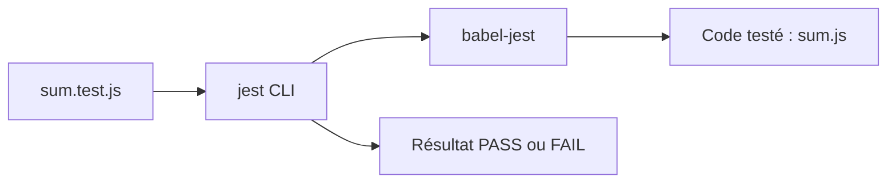

# jestjs/jest

> JavaScript testing framework for front-end and Node developers, with watch mode and snapshot tests.

## The problem
Testing JavaScript requires assembling a runner, assertions and mocks, then rerunning all the tests on every change.

## What it actually does
Runs `*.test.js` files with `expect` and matchers. Watch mode only reruns the tests related to modified files. Snapshots capture large objects to track their changes. Babel transforms the code (TypeScript via preset, without type checking).

## How it is wired

Simplified diagram based on the fiche, no diagram provided.

## Trying it
```bash
yarn add --dev jest
# ou
npm install --save-dev jest
yarn test
yarn create jest
jest my-test --notify --config=config.json
```

## Cost and gotchas
Free, requires Node. TypeScript goes through Babel: no type checking during tests. Vite integration is described as partial in the README.

## What it is not
Not a tool for testing models or data. Not browser end-to-end testing. No full Vite support.

## Alternatives
- ts-jest: to check types during tests.

## For you
Worth watching: useful only if you write a web interface or a Node service; for a Python data / AI profile, this is not your testing tool.
