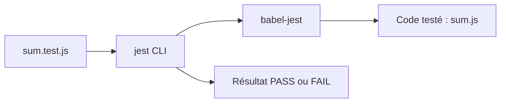

# jestjs/jest

> Framework de tests JavaScript pour développeurs front et Node, avec mode watch et tests par instantanés.

## Le problème
Tester du JavaScript demande d'assembler lanceur, assertions et simulacres, puis de relancer tous les tests à chaque changement.

## Ce que ça fait vraiment
Exécute des fichiers `*.test.js` avec `expect` et des matchers. Le mode watch ne relance que les tests liés aux fichiers modifiés. Les snapshots capturent de gros objets pour suivre leurs changements. Babel transforme le code (TypeScript via preset, sans vérification de types).

## Comment c'est branché

Schéma simplifié d'après la fiche, sans diagramme fourni.

## Essayer
```bash
yarn add --dev jest
# ou
npm install --save-dev jest
yarn test
yarn create jest
jest my-test --notify --config=config.json
```

## Coût et pièges
Gratuit, nécessite Node. TypeScript passe par Babel : aucun contrôle de types pendant les tests. L'intégration avec Vite est décrite comme partielle dans le README.

## Ce que ce n'est pas
Pas un outil de test de modèles ou de données. Pas un test de bout en bout dans un navigateur. Pas de support complet de Vite.

## Alternatives
- ts-jest : pour vérifier les types pendant les tests.

## Pour toi
À surveiller : utile seulement si tu écris une interface web ou un service Node ; pour un profil data / IA Python, ce n'est pas ton outil de test.

