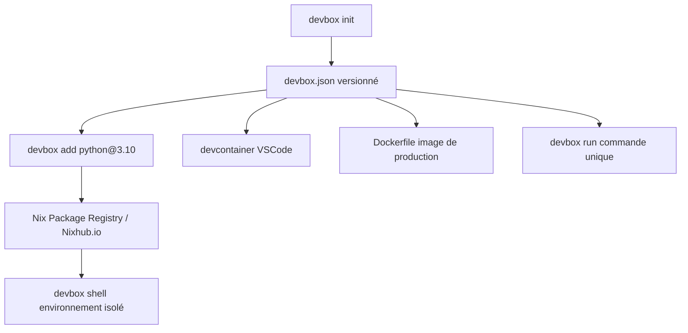

# jetify-com/devbox

> Isolated development shells declared in JSON, backed by Nix, for teams that want the same tooling.

## The problem
Installing a project's system dependencies with `brew` or `apt-get` pollutes the machine and makes team workstations diverge.
Two projects that need two versions of the same binary become impossible to make coexist.

## What it actually does
A `devbox.json` declares the list of packages; `devbox shell` opens a shell that contains them, and nothing else.
Packages come from the Nix registry (more than 400,000 versions advertised), with version pinning such as `python@3.10`.
The machine's environment variables and Git configuration remain accessible in the shell.
The same definition can also produce a VSCode devcontainer, a Dockerfile or a remote environment.

## How it is wired


## Trying it
```sh
curl -fsSL https://get.jetify.com/devbox | bash
devbox init
devbox add python@3.10
devbox shell
python --version
devbox help
```

## Cost and gotchas
Free, nothing to provision. Installation goes through a `curl | bash` script, to be read before running.
The engine is `nix`: the first `devbox add` downloads the Nix store, so expect disk usage and patience.

## What it is not
Not virtualization: the README stresses the absence of an extra layer, so it is not a security isolation.
Not a Python or Node package manager — it handles the system level, below `yarn` or `pip`.
Not independent of Nix: any package resolution problem goes back to Nix.

## Alternatives
- nix: the underlying layer, thanked in the README; use it directly if you accept its learning curve.

## For you
Good candidate for freezing the system tooling of a data project (Python, host-side CUDA excluded) without dirtying the workstation.
