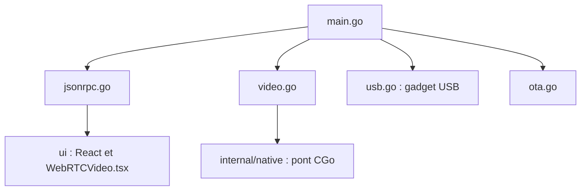

# jetkvm/kvm

> Open-source software for a KVM over IP: remote control of a server, with video, keyboard and mouse.

## The problem
When a machine no longer boots or the BIOS needs adjusting, you need remote physical keyboard-and-screen access.

## What it actually does
The JetKVM box firmware captures the target machine's video output, sends it as H.264 over WebRTC (1080p at 60 frames per second advertised, 30 to 60 ms latency) and emits keyboard, mouse and mass storage over USB. A React interface is served by the box. It offers remote access through the JetKVM cloud and optional Tailscale, signed OTA updates and time synchronization.

## How it is wired


## Trying it
```bash
./dev_deploy.sh --help
./dev_deploy.sh
```
These scripts build and deploy to a local JetKVM box.

## Cost and gotchas
The software is open but the hardware box is required. The cloud and Tailscale are optional. GPL-2.0 license. More than 370 open issues. An intermediate level in Go and TypeScript is advised to contribute.

## What it is not
It is not a software-only tool: without the hardware, it is useless. It is not a software remote desktop.

## Alternatives
No alternative named in the README.

## For you
Keep an eye on it: useful for remotely troubleshooting a GPU server or compute node in a homelab, otherwise of no interest.
