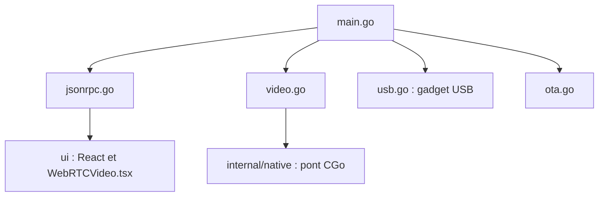

# jetkvm/kvm

> Logiciel libre d'un KVM sur IP : prise de contrôle à distance d'un serveur, avec vidéo, clavier et souris.

## Le problème
Quand une machine ne démarre plus ou qu'il faut régler le BIOS, il faut un accès physique clavier-écran à distance.

## Ce que ça fait vraiment
Le firmware du boîtier JetKVM capture la sortie vidéo de la machine cible, l'envoie en H.264 par WebRTC (1080p à 60 images par seconde annoncés, 30 à 60 ms de latence) et émet clavier, souris et stockage de masse en USB. Une interface React est servie par le boîtier. Il propose un accès distant par le cloud JetKVM et Tailscale en option, des mises à jour OTA signées et la synchronisation horaire.

## Comment c'est branché


## Essayer
```bash
./dev_deploy.sh --help
./dev_deploy.sh
```
Ces scripts compilent et déploient sur un boîtier JetKVM local.

## Coût et pièges
Le logiciel est libre mais le boîtier matériel est nécessaire. Le cloud et Tailscale sont optionnels. Licence GPL-2.0. Plus de 370 issues ouvertes. Un niveau intermédiaire en Go et TypeScript est conseillé pour contribuer.

## Ce que ce n'est pas
Ce n'est pas un outil logiciel seul : sans le matériel, il ne sert à rien. Ce n'est pas un bureau à distance logiciel.

## Alternatives
Aucune alternative nommée dans le README.

## Pour toi
À surveiller : utile pour dépanner un serveur GPU ou un nœud de calcul à distance dans un homelab, sinon sans intérêt.

