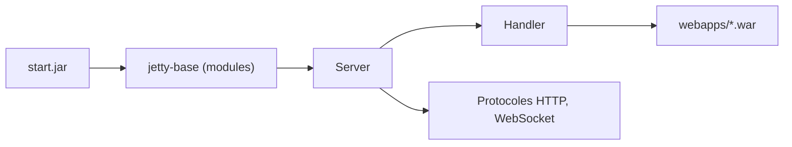

# jetty/jetty.project

> Java web server and Servlet engine, embeddable or standalone, for developers and operators of Java applications.

## The problem
Deploying a Java web application requires a Servlet server. It also needs to be embeddable in an application without a heavy installation.

## What it actually does
Serves HTTP/1, HTTP/2, HTTP/3 and WebSocket asynchronously. Runs as a classic distribution (a `jetty-base` folder, enabled modules, `.war` files dropped in `webapps`) or is embedded in Java code (`Server`, `Handler`). Several environment versions (ee8, ee11) can coexist.

## How it is wired
Simplified diagram based on the sheet, no diagram provided.



## Trying it
```bash
mkdir jetty-base && cd jetty-base
java -jar $JETTY_HOME/start.jar --add-modules=http,ee11-deploy
cp ~/src/myproj/target/mywebapp.war webapps
java -jar $JETTY_HOME/start.jar
```

## Cost and gotchas
Free. You need a JDK and the Jetty distribution (`JETTY_HOME`). The README does not state the required Java version.

## What it is not
It is not a data or AI tool: it is Java web infrastructure. The README documents neither the license nor the minimum Java version.

## Alternatives
No alternative named in the README.

## For you
Worth watching only: useful if you serve models behind a Java application, of no direct interest to a data / AI / MLOps profile otherwise.
