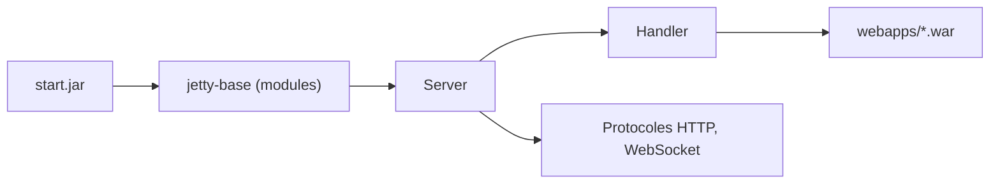

# jetty/jetty.project

> Serveur web et moteur Servlet Java, embarquable ou autonome, pour développeurs et exploitants d'applications Java.

## Le problème
Déployer une application web Java demande un serveur de Servlets. Il faut aussi pouvoir l'embarquer dans une application sans lourde installation.

## Ce que ça fait vraiment
Sert HTTP/1, HTTP/2, HTTP/3 et WebSocket de façon asynchrone. Se lance en distribution classique (dossier `jetty-base`, modules activés, fichiers `.war` déposés dans `webapps`) ou s'embarque dans le code Java (`Server`, `Handler`). Plusieurs versions d'environnement (ee8, ee11) peuvent cohabiter.

## Comment c'est branché
Schéma simplifié d'après la fiche, sans diagramme fourni.



## Essayer
```bash
mkdir jetty-base && cd jetty-base
java -jar $JETTY_HOME/start.jar --add-modules=http,ee11-deploy
cp ~/src/myproj/target/mywebapp.war webapps
java -jar $JETTY_HOME/start.jar
```

## Coût et pièges
Gratuit. Il faut un JDK et la distribution Jetty (`JETTY_HOME`). Le README ne précise pas la version de Java requise.

## Ce que ce n'est pas
Ce n'est pas un outil data ou IA : c'est de l'infrastructure web Java. Le README ne documente ni la licence ni la version de Java minimale.

## Alternatives
Aucune alternative nommée dans le README.

## Pour toi
À surveiller seulement : utile si tu sers des modèles derrière une application Java, sans intérêt direct pour un profil data / IA / MLOps sinon.

