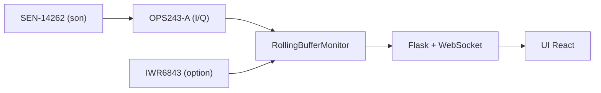

# jewbetcha/openflight

> DIY golf launch monitor built with an OPS243-A Doppler radar and a Raspberry Pi 5.

## The problem
Commercial launch monitors are expensive.

## What it actually does
A 24 GHz radar measures ball and club speed, a microphone triggers the capture, and an optional TI IWR6843 angle radar gives the launch angle. The Python software (Flask, WebSocket, React interface) computes the smash factor and an estimated carry distance. Spin and club path are labeled experimental; optional cloud sync.

## How it is wired


## Trying it
```bash
git clone https://github.com/jewbetcha/openflight.git
cd openflight
./scripts/setup/setup.sh
scripts/start-kiosk.sh --mock
```

## Cost and gotchas
Hardware: about $400 without the angle radar, about $556 with it. The IWR6843 requires custom firmware and geometry measurements: wrong values skew the result without any error.

## What it is not
Not a certified device: the project is under active development, the K-LD7 are deprecated and the ±0.5% accuracy is the radar's, as claimed by the README.

## Alternatives
No alternative named in the README.

## For you
Ignore: golf hardware project, of no interest to a data/AI profile except out of curiosity about signal processing.
