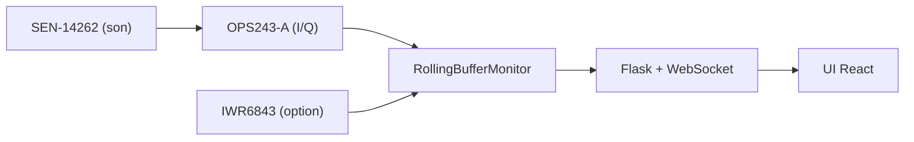

# jewbetcha/openflight

> Moniteur de lancer de golf bricolé avec un radar Doppler OPS243-A et un Raspberry Pi 5.

## Le problème
Les moniteurs de lancer commerciaux coûtent cher.

## Ce que ça fait vraiment
Un radar 24 GHz mesure vitesse de balle et de club, un micro déclenche la capture, et un radar d'angle TI IWR6843 en option donne l'angle de lancement. Le logiciel Python (Flask, WebSocket, interface React) calcule le facteur de smash et une portée estimée. Spin et trajectoire de club sont étiquetés expérimentaux ; synchronisation cloud optionnelle.

## Comment c'est branché


## Essayer
```bash
git clone https://github.com/jewbetcha/openflight.git
cd openflight
./scripts/setup/setup.sh
scripts/start-kiosk.sh --mock
```

## Coût et pièges
Matériel : environ 400 $ sans radar d'angle, environ 556 $ avec. L'IWR6843 demande un firmware sur mesure et des mesures de géométrie : de mauvaises valeurs faussent le résultat sans erreur.

## Ce que ce n'est pas
Pas un appareil certifié : le projet est en développement actif, les K-LD7 sont dépréciés et la précision de ±0,5 % est celle du radar annoncée par le README.

## Alternatives
Aucune alternative nommée dans le README.

## Pour toi
À ignorer : projet matériel de golf, sans intérêt pour un profil data/IA sauf curiosité sur le traitement du signal.

