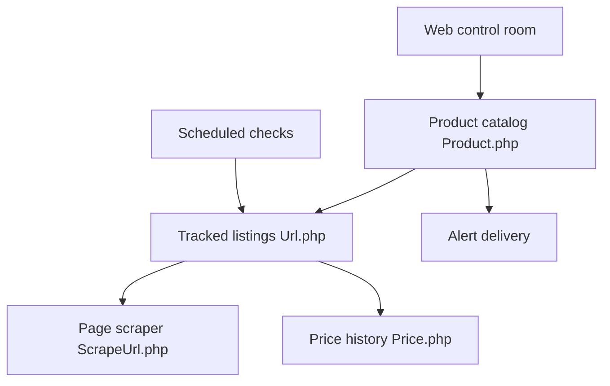

# jez500/pricebuddy

> Self-hosted price tracker: paste a product URL, it watches price and stock and notifies you.

## The problem
Price trackers only work on stores that are already integrated, and the history stays with a third party.

## What it actually does
PriceBuddy reads the title, image, price and availability of a product page, rechecks it on a schedule and keeps the history. It compares several listings of the same product, computes a unit price and notifies by email, Pushover, Gotify, Apprise, Telegram, Discord or ntfy. An optional AI (OpenAI, Anthropic, Gemini, Ollama), off by default, repairs the scraping rules. There is also a CLI with MCP and a Chrome/Edge extension.

## How it is wired
Based on the provided diagram, simplified.



## Trying it
```shell
touch .env
docker compose up -d
```
Then http://localhost:8080 (default credentials `admin@example.com` / `admin`, change them right away).

## Cost and gotchas
Free with Docker. AI keys remain optional. Affiliate codes are added for a few stores; `AFFILIATE_ENABLED=false` turns them off.

## What it is not
Not a guaranteed service: scraping breaks when a store's HTML changes. Nothing to do with a data tool.

## Alternatives
Discount Bandit, which inspired it: PriceBuddy aims to track any store without changing the code.

## For you
Worth watching: a small scraping project with optional AI, useful on a personal level, with no stakes for a data / AI / MLOps profile.
