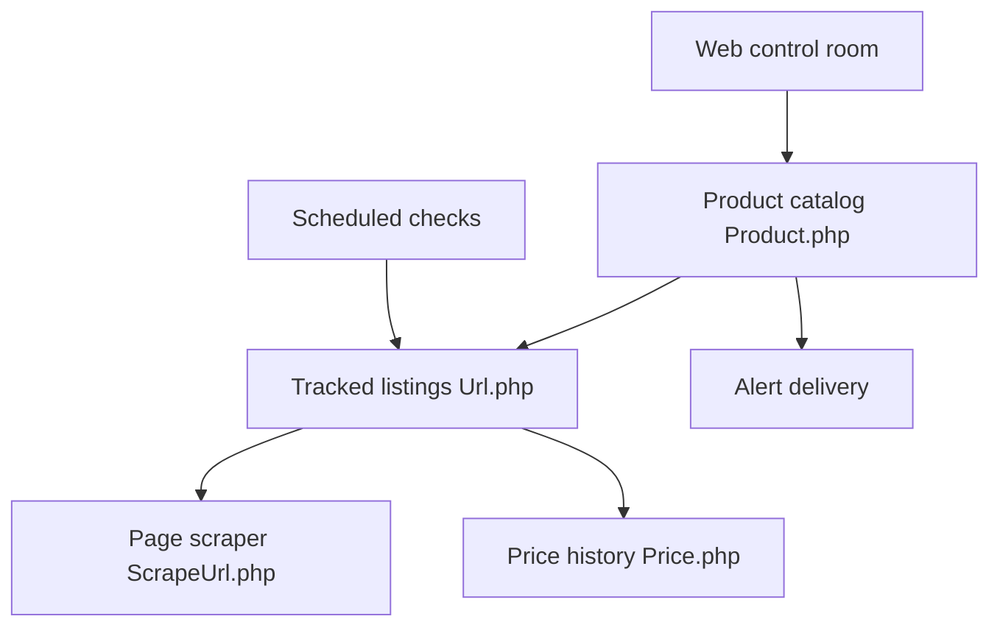

# jez500/pricebuddy

> Suivi de prix auto-hébergé : colle l'URL d'un produit, il surveille prix et stock et te prévient.

## Le problème
Les trackers de prix ne marchent que sur les magasins déjà intégrés, et l'historique reste chez un tiers.

## Ce que ça fait vraiment
PriceBuddy lit titre, image, prix et disponibilité d'une page produit, la revérifie par planification et garde l'historique. Il compare plusieurs annonces d'un même produit, calcule un prix à l'unité et notifie par e-mail, Pushover, Gotify, Apprise, Telegram, Discord ou ntfy. Une IA optionnelle (OpenAI, Anthropic, Gemini, Ollama), éteinte par défaut, répare les règles de scraping. Il existe aussi une CLI avec MCP et une extension Chrome/Edge.

## Comment c'est branché
D'après le diagramme fourni, simplifié.



## Essayer
```shell
touch .env
docker compose up -d
```
Puis http://localhost:8080 (identifiants par défaut `admin@example.com` / `admin`, à changer tout de suite).

## Coût et pièges
Gratuit en Docker. Les clés d'IA restent facultatives. Des codes d'affiliation sont ajoutés pour quelques magasins ; `AFFILIATE_ENABLED=false` les coupe.

## Ce que ce n'est pas
Pas un service garanti : le scraping casse quand le HTML d'un magasin change. Rien à voir avec un outil data.

## Alternatives
Discount Bandit, dont il s'inspire : PriceBuddy vise à suivre n'importe quel magasin sans changer le code.

## Pour toi
À surveiller : un petit projet de scraping avec IA en option, utile à titre personnel, sans enjeu pour un profil data / IA / MLOps.

