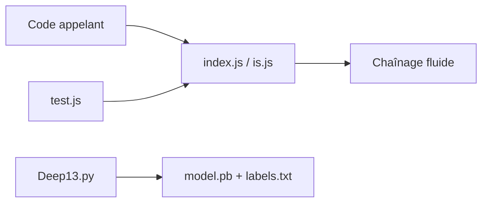

# jezen/is-thirteen

> A parody npm package that checks whether a number equals 13, with fluent syntax.

## The problem
None, it is a joke: it parodies npm micro-packages for validation.

## What it actually does
Exposes `is(13).thirteen()` and chained calls: `roughly`, `within(n).of`, `plus`, `minus`, `times`, `divideby`, `yearOfBirth`. The repository also contains an image classifier `Deep13_Image_Classifier` (Python, `model.pb` model) and a file `Assembler.oldSchool`, neither described by the README.

## How it is wired


## Trying it
```bash
npm --save i is-thirteen
npm test
```

## Cost and gotchas
Free; no license declared. The README itself warns you to read the source code.

## What it is not
Not a serious dependency for production.

## Alternatives
None named in the README.

## For you
Ignore: developer humor, with no real use and no license.
