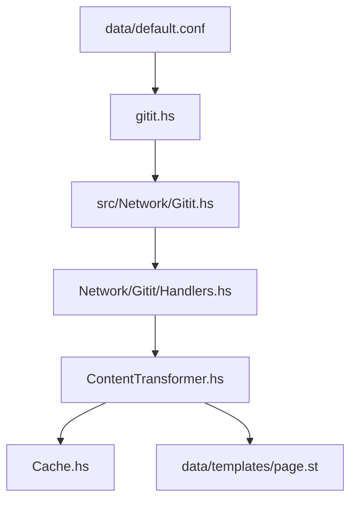

# jgm/gitit

> Wiki written in Haskell whose pages are stored in a git, darcs or mercurial repository.

## The problem
Running a wiki whose content stays versioned and editable both through the web and through version-control tools.

## What it actually does
Serves a wiki via Happstack; pandoc converts the markup (extended markdown by default, reStructuredText, LaTeX, HTML, DocBook, Org). Supports TeX math, code highlighting, categories, caching, Atom feeds, Haskell plugins and authentication (including GitHub OAuth). Pages are `.page` files in the `wikidata` repository.

## How it is wired


## Trying it
```bash
git clone https://github.com/jgm/gitit
cd gitit
stack install
gitit
gitit -f my.conf
```

## Cost and gotchas
Free. Haskell compilation (stack or cabal) and git in the path; port 5001 by default. GPL-2.0 license (copyleft). The Haskell runtime keeps some CPU busy at idle unless the `-I0` option is used.

## What it is not
Not a turnkey SaaS-style wiki: it is compiled and self-hosted. The cache is not refreshed by changes made directly through git.

## Alternatives
No alternative named in the README.

## For you
Ignore: a self-hosted Haskell wiki, unrelated to your data/AI/MLOps stack.
