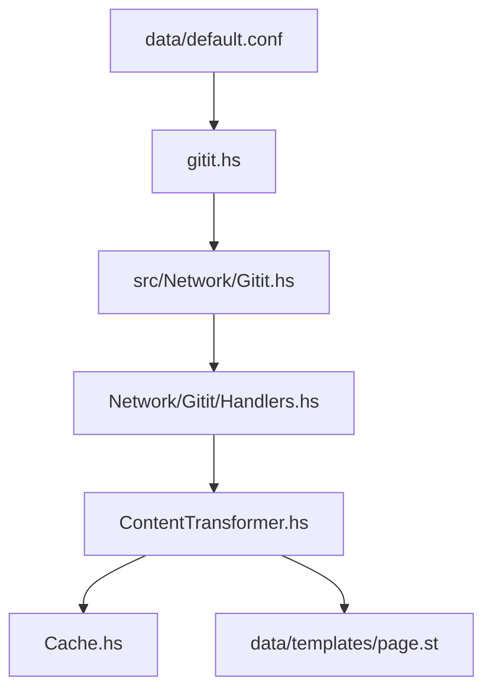

# jgm/gitit

> Wiki écrit en Haskell dont les pages sont stockées dans un dépôt git, darcs ou mercurial.

## Le problème
Tenir un wiki dont le contenu reste versionné et modifiable aussi bien par le web que par les outils du gestionnaire de versions.

## Ce que ça fait vraiment
Sert un wiki via Happstack ; pandoc convertit le balisage (markdown étendu par défaut, reStructuredText, LaTeX, HTML, DocBook, Org). Prend en charge maths TeX, coloration de code, catégories, cache, flux Atom, plugins Haskell et authentification (dont GitHub OAuth). Les pages sont des fichiers `.page` dans le dépôt `wikidata`.

## Comment c'est branché


## Essayer
```bash
git clone https://github.com/jgm/gitit
cd gitit
stack install
gitit
gitit -f my.conf
```

## Coût et pièges
Gratuit. Compilation Haskell (stack ou cabal) et git dans le chemin ; port 5001 par défaut. Licence GPL-2.0 (copyleft). Le moteur Haskell garde un peu de CPU au repos sauf avec l'option `-I0`.

## Ce que ce n'est pas
Pas un wiki clé en main façon SaaS : il se compile et s'héberge soi-même. Le cache n'est pas rafraîchi par les modifications faites directement via git.

## Alternatives
Aucune alternative nommée dans le README.

## Pour toi
À ignorer : wiki Haskell auto-hébergé, sans rapport avec ta pile data/IA/MLOps.

