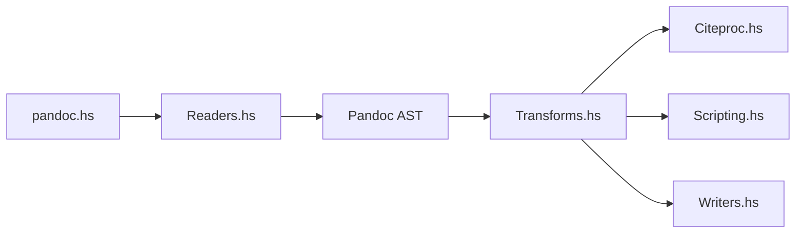

# jgm/pandoc

> Universal document format converter written in Haskell, as a library and on the command line.

## The problem
Converting by hand from one format to another (Markdown, Word, LaTeX, HTML, EPUB) loses structure and takes time.

## What it actually does
Readers turn the input into a common syntax tree, filters (including Lua) can modify it, then writers produce the output format, including PDF via LaTeX, Groff or HTML. Dozens of input and output formats, handling of citations and bibliographies. The README warns that conversions from formats richer than Pandoc's Markdown lose information.

## How it is wired

## Trying it
No command in this README: it points to the installation page and the manual at pandoc.org.

## Cost and gotchas
Free. PDF requires a LaTeX engine or equivalent installed separately. Conversions are sometimes imperfect (complex tables, fine formatting).

## What it is not
Not an editor nor a layout tool: it does not preserve margins and formatting details.

## Alternatives
No alternative named in the README.

## For you
Adopt: handy for exporting notebooks (ipynb), reports or Markdown notes to Word or PDF in your deliverables.
