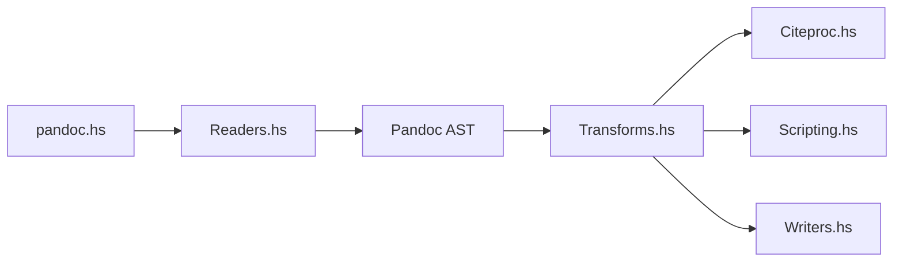

# jgm/pandoc

> Convertisseur universel de formats de documents en Haskell, en bibliothèque et en ligne de commande.

## Le problème
Passer d'un format à l'autre (Markdown, Word, LaTeX, HTML, EPUB) à la main perd la structure et prend du temps.

## Ce que ça fait vraiment
Des lecteurs transforment l'entrée en arbre syntaxique commun, des filtres (dont Lua) peuvent le modifier, puis des écrivains produisent le format de sortie, y compris PDF via LaTeX, Groff ou HTML. Dizaines de formats en entrée et en sortie, gestion de citations et bibliographies. Le README avertit que les conversions depuis des formats plus riches que le Markdown de Pandoc perdent de l'information.

## Comment c'est branché

## Essayer
Aucune commande dans ce README : il renvoie à la page d'installation et au manuel sur pandoc.org.

## Coût et pièges
Gratuit. Le PDF exige un moteur LaTeX ou équivalent installé à part. Conversions parfois imparfaites (tableaux complexes, mise en forme fine).

## Ce que ce n'est pas
Pas un éditeur ni un outil de mise en page : il ne préserve pas marges et détails de format.

## Alternatives
Aucune alternative nommée dans le README.

## Pour toi
À adopter : pratique pour exporter des notebooks (ipynb), rapports ou notes Markdown vers Word ou PDF dans tes livrables.

