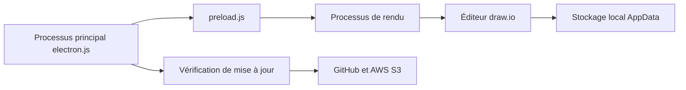

# jgraph/drawio-desktop

> An Electron desktop application around the draw.io diagram editor, usable offline.

## The problem
Drawing architecture diagrams without sending your data to an online service.

## What it actually does
The repository packages the draw.io editor (a git submodule) in Electron for Windows (installer, MSI, portable, ARM64), macOS and Linux (AppImage). The README states that no diagram data or usage statistics are sent; only an update check queries github.com, and it can be disabled (`DRAWIO_DISABLE_UPDATE=true`).

## How it is wired


## Trying it
```bash
git clone --recursive https://github.com/jgraph/drawio-desktop.git
npm install
npm start
```

## Cost and gotchas
Free under Apache-2.0. NSIS installer: administrator rights; otherwise use the MSI or the portable version. Unsigned Windows x64 binaries may trigger a SmartScreen warning (according to another document in the record: to be verified).

## What it is not
Not open to contributions: the README says so. Support is not contractual and goes through the repository.

## Alternatives
No alternative named in the README.

## For you
Adopt: a sober tool for documenting your data or MLOps architectures, with no account or cloud.
