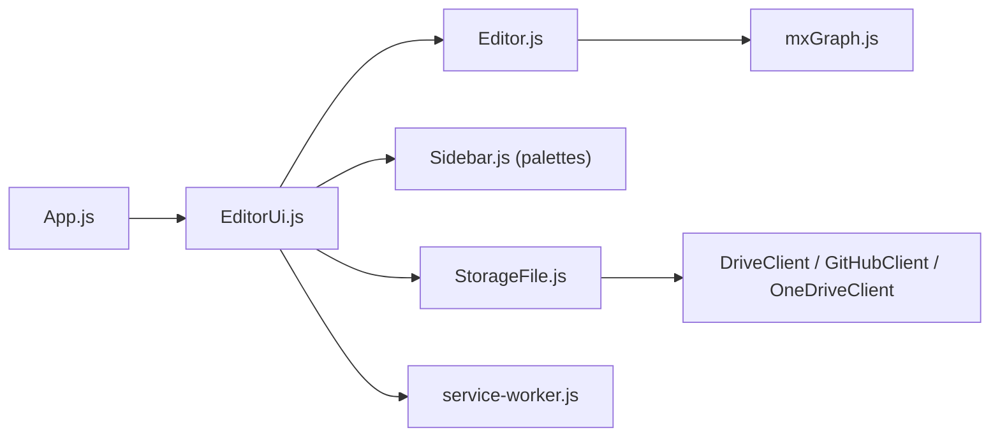

# jgraph/drawio

> Browser-based diagram and whiteboard editor, self-hostable, developed by the draw.io team.

## The problem
Drawing architecture diagrams without a proprietary tool and without sending your files to a third party.

## What it actually does
A web application: shell (`App.js`), interface (`EditorUi.js`), mxGraph graph engine with automatic layout, edge routing and undo history. It handles shape palettes, import (VSDX), export, and storage in the browser, Google Drive, Dropbox, GitHub, GitLab and OneDrive. A service worker provides the offline cache.

## How it is wired

## Trying it
The README gives no command. Three options: fork the repository and publish on GitHub Pages, use the official Docker image, or download draw.io Desktop. .war files are in the releases.

## Cost and gotchas
Free. The team does not accept pull requests. The "draw.io" brand is registered in the EU: do not reuse the name or logo without written permission.

## What it is not
Not an SVG editor (SVG export is for web embedding). No real-time collaboration in this version.

## Alternatives
No alternative named in the README.

## For you
Adopt: a mature architecture-diagram tool, self-hostable with Docker, useful for documenting data and ML pipelines without an external provider.
