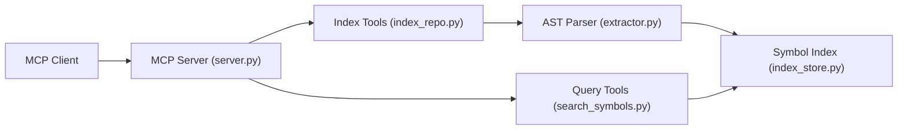

# jgravelle/jcodemunch-mcp

> MCP server that indexes a repository by syntax tree so the agent reads symbols, not files.

## The problem
Coding agents re-read whole files; context is wasted and tokens cost money.

## What it actually does
Indexes code with tree-sitter (70+ languages) into a local SQLite index (`~/.code-index/`). Tools: `search_symbols`, `get_symbol_source`, `find_importers`, `get_blast_radius`, `assemble_task_context`. On 3 public repositories, the author measures 28.3x fewer tokens than an agent that reads files (methodology published).

## How it is wired


## Trying it
```bash
uv tool install jcodemunch-mcp
jcodemunch-mcp init
claude mcp add -s user jcodemunch -- uvx jcodemunch-mcp
```

## Cost and gotchas
Free for non-commercial use; paid for commercial use (from $79 to $1,999 depending on the plan). Anonymous savings counter by default (can be disabled). Custom license ("Dual-Use"), not recognized by GitHub.

## What it is not
Not open source in the usual sense: renaming or publishing to a registry is forbidden. No gain when the whole file has to be read. Self-reported marketing figures.

## Alternatives
No alternative named in the README.

## For you
Keep an eye on it: token savings are plausible and the methodology is published, but the license with commercial clauses must be validated before any professional use.
