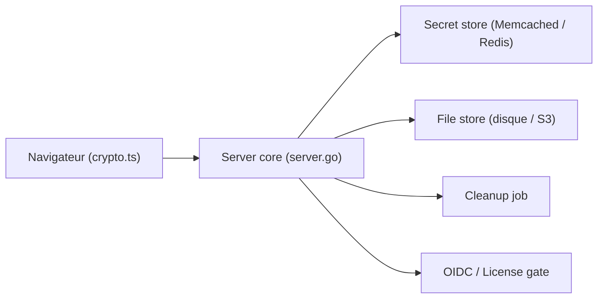

# jhaals/yopass

> Self-hosted service for sharing passwords and files, encrypted in the browser.

## The problem
Sending credentials by e-mail or chat leaves plain text in the histories.

## What it actually does
The browser encrypts the secret with OpenPGP using a random key. The server only stores the encrypted data, with an expiry. The link carries the key in its URL fragment, which is never sent to the server. A one-time secret is deleted after it is read. Storage goes through Memcached or Redis, and files go to disk or S3.

## How it is wired


## Trying it
```bash
docker network create yopass
docker run -d --name yopass-memcached --network yopass memcached
docker run -d --name yopass --network yopass \
  -p 127.0.0.1:1337:1337 \
  jhaals/yopass --memcached=yopass-memcached:11211
```

## Cost and gotchas
The free edition costs nothing. A commercial license unlocks OIDC, themes, auditing and files larger than 1 MB. HTTPS is mandatory in production.

## What it is not
Not a password manager. Without TLS, confidentiality is not guaranteed. The public demo instance is for testing only.

## Alternatives
No alternative named in the README.

## For you
Adopt it to share API keys and tokens within a team without leaving them in Slack: simple deployment, maintained since 2014.
