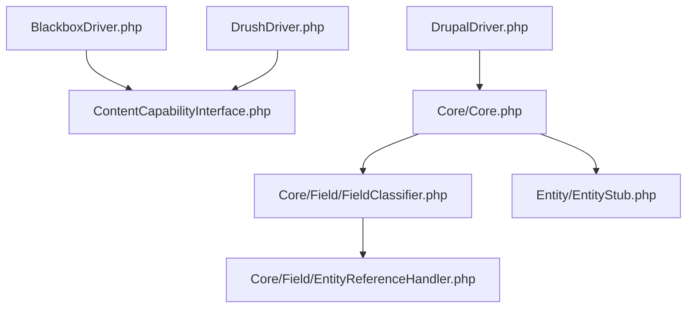

# jhedstrom/DrupalDriver

> Lightweight PHP drivers to manipulate Drupal from automated tests.

## The problem
Drupal behaviour tests need a uniform way to create content and users.

## What it actually does
Three drivers share one interface: blackbox (HTTP only), Drupal API (direct bootstrap in PHP) and Drush. The API driver delegates to a Core that picks a field handler by type; handlers and the Core can be replaced without forking. Version 3 targets Drupal 10 and 11, PHP 8.2 minimum.

## How it is wired


## Trying it
```bash
composer require drupal/drupal-driver
```

## Cost and gotchas
PHP 8.2+ and Composer are required (not listed in the plan's prerequisites). Drupal 7 or PHP 8.1 require the 2.x branch. GPL-2.0 licence.

## What it is not
Not complete: the drivers are meant for tests and do not cover the whole Drupal API.

## Alternatives
No alternative named in the README.

## For you
Ignore: Drupal testing tooling, outside the data, AI or MLOps field.
