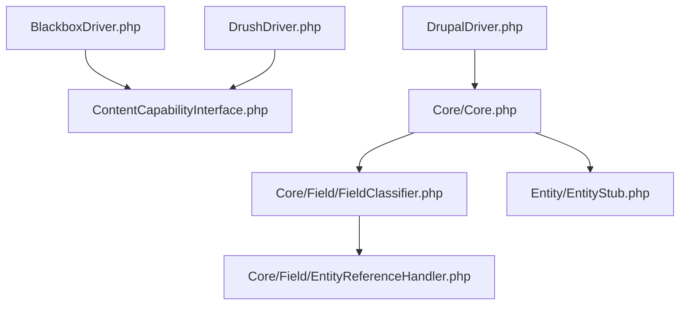

# jhedstrom/DrupalDriver

> Pilotes PHP légers pour manipuler Drupal depuis des tests automatisés.

## Le problème
Les tests de comportement Drupal ont besoin d'un moyen uniforme de créer du contenu et des utilisateurs.

## Ce que ça fait vraiment
Trois pilotes partagent une interface : boîte noire (HTTP seulement), API Drupal (amorçage direct en PHP) et Drush. Le pilote API délègue à un Core qui choisit un gestionnaire de champ par type ; les gestionnaires et le Core se remplacent sans fork. La version 3 vise Drupal 10 et 11, PHP 8.2 minimum.

## Comment c'est branché


## Essayer
```bash
composer require drupal/drupal-driver
```

## Coût et pièges
PHP 8.2+ et Composer requis (non listés dans les prérequis du plan). Drupal 7 ou PHP 8.1 imposent la branche 2.x. Licence GPL-2.0.

## Ce que ce n'est pas
Pas complet : les pilotes sont destinés aux tests et ne couvrent pas toute l'API Drupal.

## Alternatives
Aucune alternative nommée dans le README.

## Pour toi
À ignorer : outillage de test Drupal, hors du champ data, IA ou MLOps.

