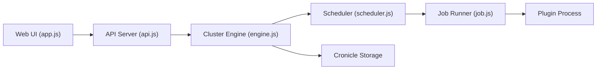

# jhuckaby/Cronicle

> Multi-server job scheduler with a web interface, an enriched replacement for cron, written in Node.js.

## The problem
Cron offers no centralized view, no live logs, and no failover to a standby server.

## What it actually does
A primary server keeps the clock and assigns jobs to worker servers (groups, automatic failover, discovery). Jobs are shell commands or plugins in any language, exchanging JSON. Web interface with live log, CPU and memory statistics, time zones, queue, webhooks, REST API and API keys.

## How it is wired


## Trying it
```bash
# Aucune commande documentée dans ce README : l'installation renvoie
# à la page « Installation & Setup » de la documentation (liens non repris ici).
```

## Cost and gotchas
Free. Modules listed as dependencies (MIT, BSD, OFL); the license of the repo itself is "present but unidentified": read it before use. The README announces that xyOps is the successor and that Cronicle only receives bug and security fixes.

## What it is not
Not a workflow orchestrator with dependencies between tasks: the README describes scheduled events and jobs. Not a project under feature development.

## Alternatives
xyOps (pixlcore/xyops): successor announced by the author, to be preferred for a new project.

## For you
Keep an eye on it: handy for scheduled jobs (retraining, exports) on a few machines, but in maintenance mode; look at xyOps before committing.
