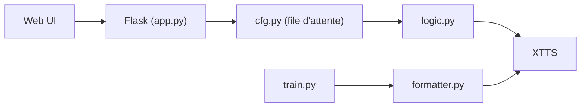

# jianchang512/clone-voice

> Local web tool for voice cloning (XTTS v2), text-to-voice or voice-to-voice, 16 languages.

## The problem
Synthesizing a text with a reference voice without a GPU or a cloud service.

## What it actually does
Flask web interface on 127.0.0.1:9988. Text→voice (SRT import possible) and voice→voice from a 5 to 20 s sample (file or microphone). CUDA used if available. A training screen fine-tunes XTTS (Whisper transcription, `train.py`). Precompiled Windows version (1.7 GB + 3 GB of model).

## How it is wired


## Trying it
```bash
python -m venv venv
pip install -r requirements.txt --no-deps
python code_dev.py
python app.py
```

## Cost and gotchas
Free. From source: Python 3.9–3.11, ffmpeg, a stable proxy to download the models, and manual modification of third-party libraries according to the README.

## What it is not
XTTS model under the Coqui Public Model License: research only, no commercial use. Repository archived. Chinese quality is "decent" according to the author.

## Alternatives
None named (related projects by the same author: video translation, speech recognition).

## For you
Ignore: archived, non-commercial model license and fragile installation; look for a maintained TTS.
