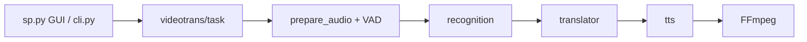

# jianchang512/pyvideotrans

> Tool for automatic video translation and dubbing, from subtitling to speech synthesis.

## The problem
Translating a video means chaining transcription, translation, synthetic voice and re-editing by hand.

## What it actually does
Complete chain: speech recognition (local Faster-Whisper or API), translation (LLM or classic services, Ollama locally), multi-role speech synthesis with cloning (F5-TTS, CosyVoice, GPT-SoVITS), then recomposition with FFmpeg. Qt, CLI, WebUI and Docker interfaces; pause and manual correction at each step. The code is organized as interchangeable adapters for ASR, translation and TTS.

## How it is wired


## Trying it
```bash
git clone https://github.com/jianchang512/pyvideotrans.git
cd pyvideotrans
uv sync
uv run sp.py
uv run cli.py --task stt --name "./audio.wav" --model_name large-v3
```

## Cost and gotchas
FFmpeg required; NVIDIA GPU recommended (CUDA 12.8, cuDNN 9.11). Third-party APIs (OpenAI, Azure, etc.) are at your expense. The README disclaims all responsibility for the protected content processed.

## What it is not
Not a model: it is an orchestrator of existing models and APIs. Dubbing quality varies.

## Alternatives
The README cites no direct alternative.

## For you
Worth watching: a good testbed for chaining ASR, LLM and TTS locally, but heavy to install and dependent on many keys.
