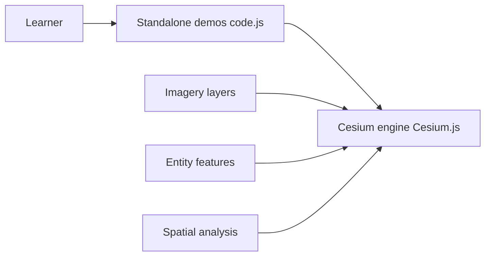

# jiawanlong/Cesium-Examples

> Collection of native Cesium demos for learning 3D web mapping, with spatial analysis.

## The problem
Cesium beginners lack complete examples without an extra layer for prototyping a 3D map.

## What it actually does
Standalone demos (one file per example): imagery (xyz, wms, wmts), vectors (shp, geojson, mvt), terrain, entities and primitives, glb/3D Tiles models, analyses (visibility, flooding, cross-sections), video fusion, effects, particles, physics, visualizations (winds, heat, currents). To be served through a web server such as nginx.

## How it is wired


## Trying it
```bash
# Aucune commande : copier le projet complet sous nginx (ou autre conteneur web),
# ou ouvrir https://jiawanlong.github.io/Cesium-Examples/
```

## Cost and gotchas
Free. No license: the right to reuse the code is undefined, despite the README's "free, no permission required" statement. Documentation in Chinese.

## What it is not
Not a library: examples. The architecture diagram could not inspect the demos, only the embedded Cesium engine.

## Alternatives
Superdéfinir mars3d and SuperMap (cited as heavier competitors).

## For you
Ignore: useful only if you do 3D geovisualization, and the lack of a license makes reuse risky.
