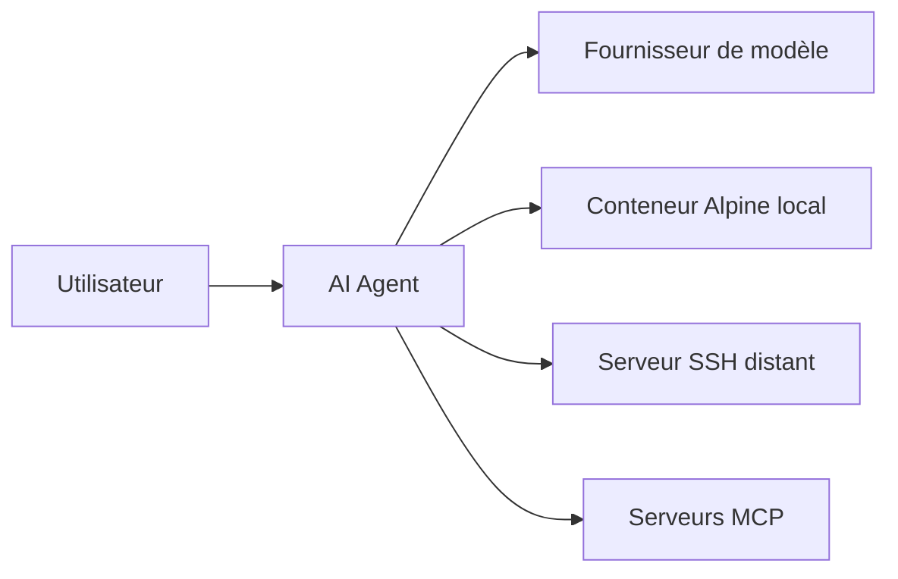

# jieapi/AiCode

> AI coding agent for Android with an embedded Linux environment, also usable on a remote SSH server.

## The problem
Coding with an AI agent requires a computer and a configured development environment; on a phone, nothing complete exists.

## What it actually does
An Android application embeds an Alpine Linux container (Termux and PRoot) and a terminal. The agent reads and writes files, runs shell commands, launches builds, with a built-in browser, sub-agents, skills and MCP servers. Models are not provided: you configure your own providers (OpenAI, Anthropic, Gemini protocols). An SSH mode moves execution to a server.

## How it is wired
Simplified diagram based on the sheet, no diagram provided.


## Trying it
```bash
# Pas de commande : installation depuis GitHub Releases
# (armsolo pour un vrai appareil, x86solo pour un émulateur, universal sinon).
# Ensuite : Réglages > AI 供应商 pour configurer un modèle,
# puis Containers et images, puis nouvelle session.
```

## Cost and gotchas
Android 8.0 or later (arm64-v8a or x86_64). Models and keys are at your expense. The README is in Chinese, with sponsor and advertising inserts; the GPL-3.0 license requires derivatives to be open.

## What it is not
Not a model nor a service: no AI is included. Not a desktop tool. AUTO mode runs everything without asking for permission.

## Alternatives
OpenCode: the README cites it as the main source of inspiration, without presenting it as an alternative.

## For you
Worth watching: a mobile coding agent with MCP and SSH is a practical curiosity, but a single maintainer and Chinese documentation hold back serious use.
