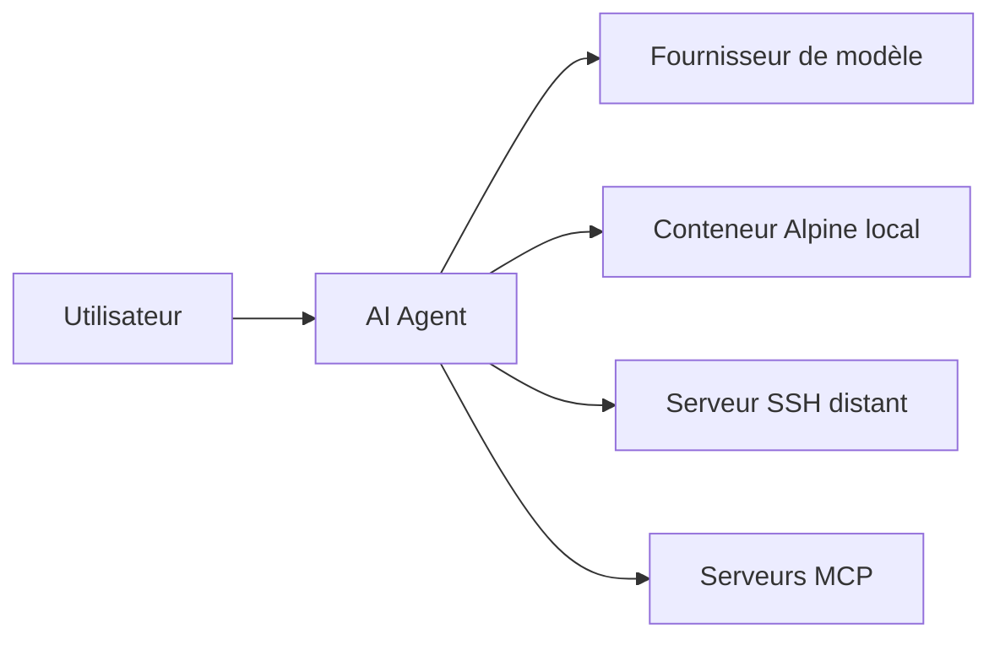

# jieapi/AiCode

> Agent de code IA pour Android avec un environnement Linux embarqué, utilisable aussi sur un serveur SSH distant.

## Le problème
Coder avec un agent IA oblige à avoir un ordinateur et un environnement de développement configuré ; sur téléphone, rien de complet n'existe.

## Ce que ça fait vraiment
Une application Android embarque un conteneur Alpine Linux (Termux et PRoot) et un terminal. L'agent lit et écrit des fichiers, exécute des commandes shell, lance des builds, avec un navigateur intégré, des sous-agents, des skills et des serveurs MCP. Les modèles ne sont pas fournis : on configure ses propres fournisseurs (protocoles OpenAI, Anthropic, Gemini). Un mode SSH déporte l'exécution sur un serveur.

## Comment c'est branché
Schéma simplifié d'après la fiche, sans diagramme fourni.


## Essayer
```bash
# Pas de commande : installation depuis GitHub Releases
# (armsolo pour un vrai appareil, x86solo pour un émulateur, universal sinon).
# Ensuite : Réglages > AI 供应商 pour configurer un modèle,
# puis Containers et images, puis nouvelle session.
```

## Coût et pièges
Android 8.0 ou plus (arm64-v8a ou x86_64). Les modèles et clés sont à ta charge. Le README est en chinois, avec des encarts de sponsors et de publicité ; la licence GPL-3.0 impose de rendre les dérivés ouverts.

## Ce que ce n'est pas
Pas un modèle ni un service : aucune IA n'est incluse. Pas un outil pour ordinateur de bureau. Le mode AUTO exécute tout sans demande d'autorisation.

## Alternatives
OpenCode : le README le cite comme source d'inspiration principale, sans le présenter comme alternative.

## Pour toi
À surveiller : un agent de code mobile avec MCP et SSH est une curiosité pratique, mais un seul mainteneur et une documentation en chinois freinent un usage sérieux.

