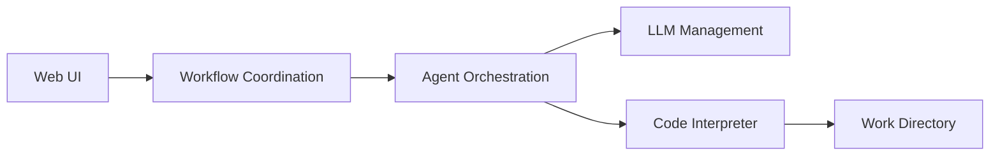

# jihe520/MathModelAgent

> Agents and skills that automatically write a mathematical modeling competition paper.

## The problem
A modeling competition (CUMCM, MCM/ICM) demands analysis, code, figures and a formatted paper within three days.

## What it actually does
Original version: modeler, coder (local Jupyter interpreter or E2B/Daytona) and writer agents, one model per agent through LiteLLM.
Web UI + FastAPI backend + Redis; options for web search (Tavily), RAG (ChromaDB), human in the loop.
New direction: a set of skills for Claude Code or Codex (`/1start-mathmodel`), 17 Typst templates, 9 verification steps.
Ready-to-use desktop version.

## How it is wired


## Trying it
```bash
npx skills add jihe520/MathModelAgent --all
git clone https://github.com/jihe520/MathModelAgent.git
docker-compose up
```

## Cost and gotchas
LLM key at your expense; skills mode is launched with `--dangerously-skip-permissions` / `--yolo`, so with no safeguards.

## What it is not
Not capable of winning a competition according to the author himself; experimental demo project, with no license, README in Chinese.

## Alternatives
No alternative named (Agent Laboratory, TaskWeaver cited as references, not as alternatives).

## For you
Worth watching: the architecture of skills + Typst templates + automatic verification is a good case study for generating reports, not a tool to deploy.
