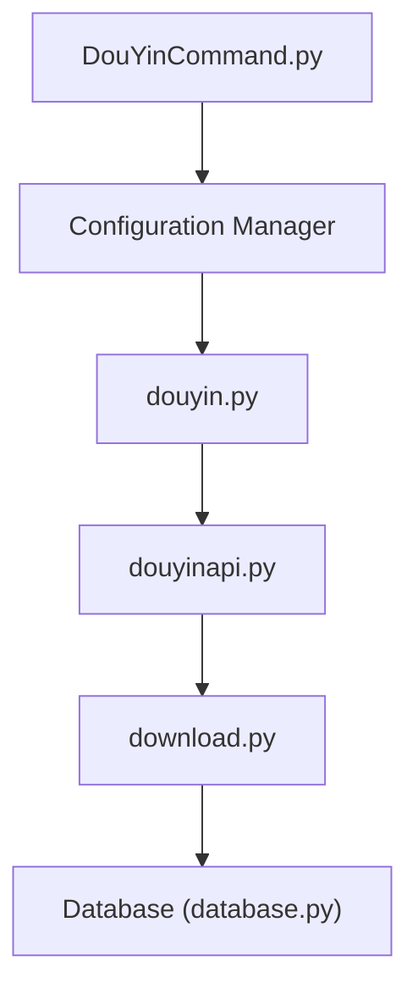

# jiji262/douyin-downloader

> Downloads Douyin videos and photos without a watermark, via a desktop app or a Python CLI.

## The problem
Bulk-retrieving a Douyin creator's content, without the platform's watermark.

## What it actually does
The Python CLI (Douyin only) handles batch downloads, date filters, resumption, history, optional comments and transcription, plus an optional REST API. The Douzy desktop app extends to TikTok, YouTube, Telegram and X, with some advanced features requiring activation. The README acknowledges that Douyin's request verification currently blocks CLI downloads of videos, collections, music, likes and favorites.

## How it is wired

This diagram reflects the old structure; the current README uses `run.py`.

## Trying it
```bash
git clone https://github.com/jiji262/douyin-downloader.git
cd douyin-downloader
python -m pip install -r requirements.txt
python -m pip install playwright
python -m playwright install chromium
cp config.example.yml config.yml
python -m tools.cookie_fetcher --config config.yml
python run.py -c config.yml
```

## Cost and gotchas
Python 3.9+, Douyin login cookies, Chromium via Playwright. Douzy has features behind activation. Respecting copyright and the platform's terms is on you.

## What it is not
Not a reliable tool today: the author advises against the CLI for everyday use. The desktop software is not in this code repository.

## Alternatives
Douzy, the desktop app cited by the README, replaces the CLI.

## For you
Ignore: outside your data/AI/MLOps profile and, according to the README, the CLI is blocked for most uses.
