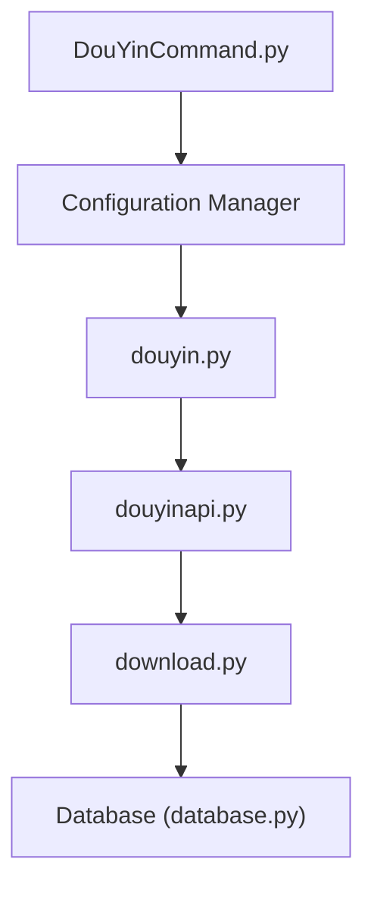

# jiji262/douyin-downloader

> Télécharge vidéos et photos Douyin sans filigrane, via une application de bureau ou une CLI Python.

## Le problème
Récupérer en lot les contenus d'un créateur Douyin, sans le filigrane de la plateforme.

## Ce que ça fait vraiment
La CLI Python (Douyin seulement) gère téléchargements par lot, filtres de dates, reprises, historique, commentaires et transcription facultatifs, plus une API REST optionnelle. L'application de bureau Douzy étend à TikTok, YouTube, Telegram et X, certaines fonctions avancées demandant une activation. Le README reconnaît que la vérification des requêtes de Douyin bloque actuellement les téléchargements de vidéos, collections, musiques, likes et favoris en CLI.

## Comment c'est branché

Ce schéma reflète l'ancienne structure ; le README actuel utilise `run.py`.

## Essayer
```bash
git clone https://github.com/jiji262/douyin-downloader.git
cd douyin-downloader
python -m pip install -r requirements.txt
python -m pip install playwright
python -m playwright install chromium
cp config.example.yml config.yml
python -m tools.cookie_fetcher --config config.yml
python run.py -c config.yml
```

## Coût et pièges
Python 3.9+, cookies de connexion Douyin, Chromium via Playwright. Douzy a des fonctions sous activation. Respect des droits d'auteur et des conditions de la plateforme à ta charge.

## Ce que ce n'est pas
Pas un outil fiable aujourd'hui : l'auteur déconseille la CLI pour l'usage courant. Le logiciel de bureau n'est pas dans ce dépôt de code.

## Alternatives
Douzy, l'application de bureau citée par le README, remplace la CLI.

## Pour toi
À ignorer : hors de ton profil data/IA/MLOps et, selon le README, la CLI est bloquée pour l'essentiel.

