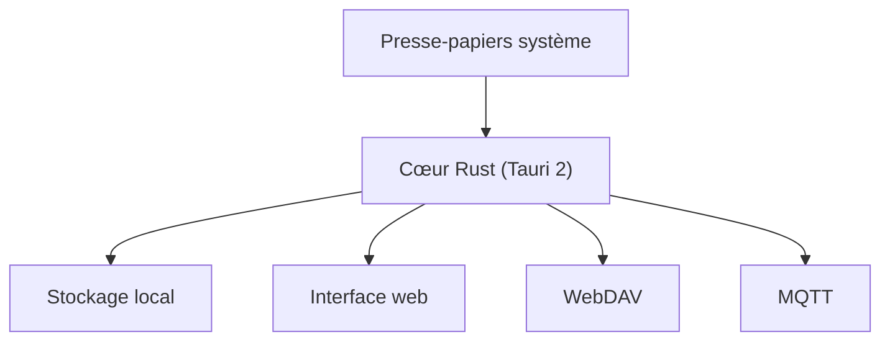

# jimuzhe/tiez-clipboard

> Desktop clipboard history manager built with Tauri and Rust, with WebDAV sync.

## The problem
The system clipboard keeps only one item and does not sync between devices.

## What it actually does
Captures text, rich text, images and file paths. Tags, search, masking of sensitive data in previews, eight themes. Syncs via WebDAV and MQTT, transfers files on the local network and relays verification codes.

## How it is wired
Simplified diagram based on the sheet, no diagram provided.

## Trying it
No command in the README; the Installation section is empty, releases are on the releases page.

## Cost and gotchas
Free, GPL-3.0. Sync requires your own WebDAV or MQTT server. The exact platforms are not readable in the sheet.

## What it is not
Not a data or AI tool, despite the README mentioning "AI-assisted actions" without detail. No guarantee on encryption: not documented.

## Alternatives
Not documented in the README.

## For you
Ignore: desktop utility unrelated to your field, and the sheet is too thin to judge the security of the transfer.
