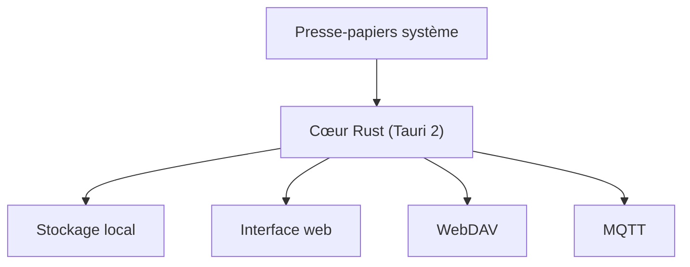

# jimuzhe/tiez-clipboard

> Gestionnaire d'historique du presse-papiers de bureau en Tauri et Rust, avec synchronisation WebDAV.

## Le problème
Le presse-papiers du système ne garde qu'un élément et ne se synchronise pas entre appareils.

## Ce que ça fait vraiment
Capture texte, texte riche, images et chemins de fichiers. Étiquettes, recherche, masquage de données sensibles dans les aperçus, huit thèmes. Synchronise via WebDAV et MQTT, transfère des fichiers en réseau local et relaie des codes de vérification.

## Comment c'est branché
Schéma simplifié d'après la fiche, sans diagramme fourni.

## Essayer
Aucune commande dans le README ; la section Installation est vide, les versions sont sur la page des releases.

## Coût et pièges
Gratuit, GPL-3.0. La synchronisation demande ton propre serveur WebDAV ou MQTT. Les plateformes exactes ne sont pas lisibles dans la fiche.

## Ce que ce n'est pas
Pas un outil de données ou d'IA, malgré la mention d'« actions assistées par IA » dans le README, sans détail. Pas de garantie sur le chiffrement : non documenté.

## Alternatives
Non documenté dans le README.

## Pour toi
À ignorer : utilitaire de bureau sans lien avec ton métier, et la fiche est trop mince pour juger la sécurité du transfert.

