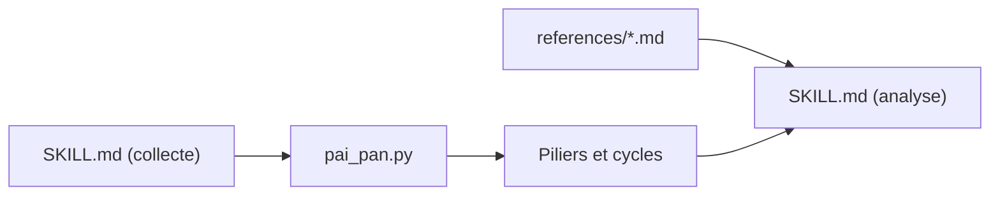

# jinchenma94/bazi-skill

> Claude Code skill that computes a Chinese birth chart (Bazi) and comments on it based on nine classics.

## The problem
Computing the four pillars, the major cycles and their reading requires tables and calendar rules.

## What it actually does
The skill collects name, date, time, sex and place, calls `scripts/pai_pan.py` (standard Python, no dependencies) to establish the pillars and cycles, then writes an analysis (strength of the day master, elements, cycles). The content of `SKILL.md` was not read in detail. The README is in Chinese.

## How it is wired


## Trying it
```bash
mkdir -p .claude/skills
git clone https://github.com/jinchenma94/bazi-skill .claude/skills/bazi
python3 scripts/pai_pan.py --solar 1990-05-15 --shichen 午 --sex 男
```

## Cost and gotchas
Free; python3 3.6+. Birth date and time are entered in the conversation, so they are entrusted to the model.

## What it is not
Entertainment: the README states that the analysis is not a basis for any decision.

## Alternatives
None cited in the README.

## For you
Cultural curiosity, no value for data/AI work: ignore.
