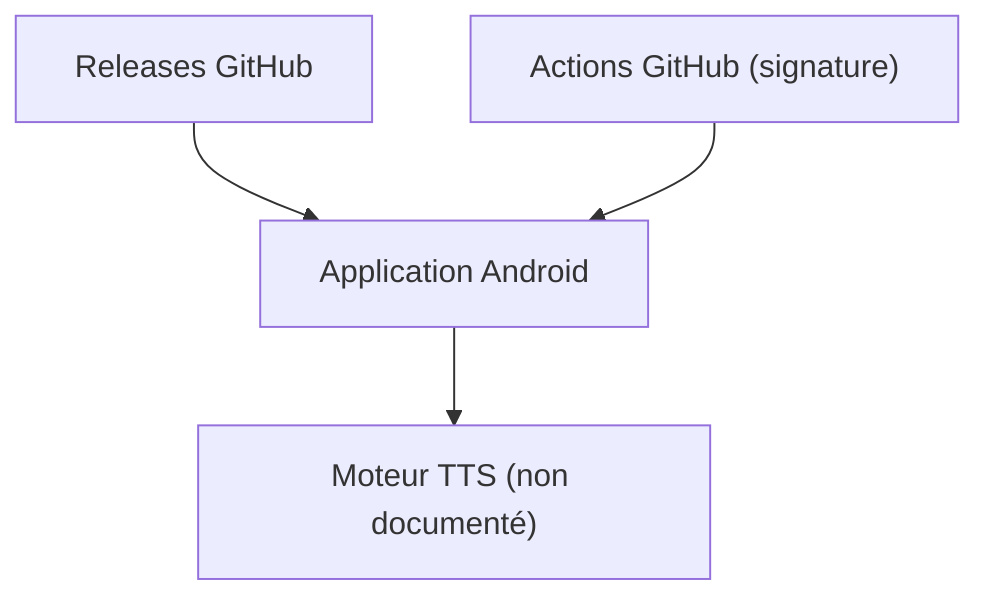

# jing332/tts-server-android

> Android text-to-speech application (TTS engine) whose README describes almost nothing.

## The problem
Not documented: the README does not say what the application is for. The name suggests a speech synthesis server for Android.

## What it actually does
The README only contains download links, a masked screenshot and acknowledgments to other projects (legado, ms-ra-forwarder, ExoPlayer, Rhino...). The actual features are not described: insufficient material.

## How it is wired
Simplified diagram based on the sheet, no diagram provided.



## Trying it
No usage command documented. To build, the README describes a `local.properties` file (signing key) or GitHub Actions secrets.

```bash
openssl base64 < key.jks | tr -d '\r\n' | tee key.jks.base64.txt
```

## Cost and gotchas
Free, stable version via Releases. No license declared: reuse rights unknown. README in Chinese, download mirror on a third-party service.

## What it is not
Not documented as an AI or data tool. No description of its voices or its sources.

## Alternatives
No alternative named in the README.

## For you
Ignore: undocumented function, no license, and a subject foreign to a data / AI / MLOps profile.
