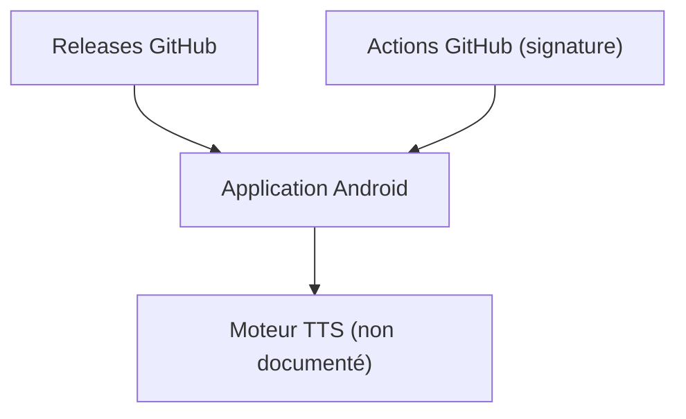

# jing332/tts-server-android

> Application Android de synthèse vocale (moteur TTS) dont le README ne décrit presque rien.

## Le problème
Non documenté : le README ne dit pas à quoi sert l'application. Le nom suggère un serveur de synthèse vocale pour Android.

## Ce que ça fait vraiment
Le README ne contient que des liens de téléchargement, une capture masquée et des remerciements à d'autres projets (legado, ms-ra-forwarder, ExoPlayer, Rhino...). Les fonctions réelles ne sont pas décrites : matière insuffisante.

## Comment c'est branché
Schéma simplifié d'après la fiche, sans diagramme fourni.



## Essayer
Aucune commande d'usage documentée. Pour compiler, le README décrit un fichier `local.properties` (clé de signature) ou des secrets GitHub Actions.

```bash
openssl base64 < key.jks | tr -d '\r\n' | tee key.jks.base64.txt
```

## Coût et pièges
Gratuit, version stable via Releases. Aucune licence déclarée : droits de réutilisation inconnus. README en chinois, miroir de téléchargement sur un service tiers.

## Ce que ce n'est pas
Pas documenté comme un outil d'IA ou de data. Pas de description de ses voix ni de ses sources.

## Alternatives
Aucune alternative nommée dans le README.

## Pour toi
À ignorer : fonction non documentée, licence absente et sujet étranger à un profil data / IA / MLOps.

