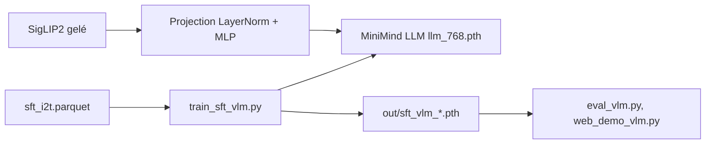

# jingyaogong/minimind-v

> Complete code to train a small 65M-parameter vision-language model from scratch, as a tutorial.

## The problem
Understanding how a VLM is built without starting from a multi-billion-parameter model or an unaffordable training cost.

## What it actually does
A frozen SigLIP2 vision encoder, a projection (LayerNorm and two-layer MLP) to 64 visual tokens, then a small MiniMind LLM of which only the projection and the outer layers are trained. The repository provides structure, data cleaning, optional pre-training and SFT (ALLaVA-4V, about 2.9 million samples). The "65M" does not count the encoder (~95M frozen): the full model approaches 160M. The README itself judges the result as "understands the general meaning, imprecise details".

## How it is wired


## Trying it
```bash
git clone --depth 1 https://github.com/jingyaogong/minimind-v
pip install -r requirements.txt -i https://pypi.tuna.tsinghua.edu.cn/simple
modelscope download --model gongjy/siglip2-base-p32-256-ve --local_dir ./model/siglip2-base-p32-256-ve
modelscope download --model gongjy/minimind-3v-pytorch llm_768.pth --local_dir ./out
python train_sft_vlm.py --epochs 2 --from_weight llm
python eval_vlm.py --load_from model --weight sft_vlm
```

## Cost and gotchas
About 2 h on an RTX 3090 and 3 CNY of GPU rental for one SFT epoch (author's figures). The base LLM is not trained from scratch. The generated diagram cites CLIP and a linear projection, contradicted by the README (SigLIP2, MLP): follow the README.

## What it is not
It is not a VLM usable in production: hallucinations and repetitions are acknowledged. "From scratch" applies to the VLM part, not to the language part.

## Alternatives
LLaVA and Qwen-VL are cited as comparable models; MiniMind-O for omni-modal.

## For you
Adopt as a learning resource: a VLM readable end to end that you can train on a consumer card, keeping in mind that it is not a production building block.
