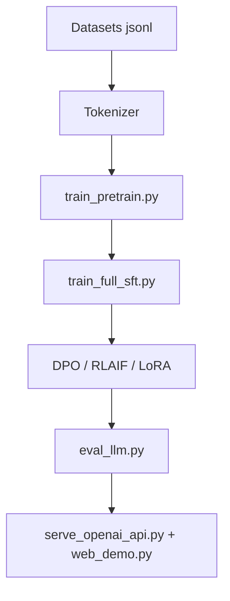

# jingyaogong/minimind

> PyTorch code to train a small 64M-parameter language model from scratch, for learning purposes.

## The problem
Libraries like Transformers, TRL, or PEFT allow you to summarize the inner workings of an LLM in just a few lines. It's difficult to fully understand each step of a complete training process.

## What it actually does
Provides the code for a Dense and MoE (Qwen3-aligned) model, a 6,400-token tokenizer, and training scripts: pre-training, SFT, LoRA, distillation, DPO, RLAIF (PPO, GRPO, CISPO) and Agentic RL. The algorithms have been rewritten in native PyTorch. An OpenAI-compatible server and a Streamlit page serve the results. The datasets are published separately (ranging from 1.2 GB to 14 GB).

## How it is wired


## Trying it
```bash
git clone --depth 1 https://github.com/jingyaogong/minimind
cd minimind && pip install -r requirements.txt
cd trainer && python train_pretrain.py
cd trainer && python train_full_sft.py
python eval_llm.py --weight full_sft
```

## Cost and gotchas
Announced at approximately 3 yuan and 2 hours on a 3090 GPU for the "mini" SFT stage. The complete dataset weighs 10 GB (pre-training) and 14 GB (SFT). The 64M model remains limited: the README acknowledges that factual knowledge is weak.

## What it is not
This is not a production-ready model. It is not a wrapper: everything is re-implemented, so there is no guarantee of parity with Transformers. The tool calling was trained on a dozen simulated tools, without any proven generalization.

## Alternatives
- transformers / trl / peft: for quickly fine-tuning an existing model without rewriting the algorithms.
- llama.cpp, vllm, ollama: These are tools used to serve the model once it has been converted.

## For you
Useful for understanding the entire pre-training chain towards RL with a modest GPU; it should be monitored and read, but not deployed.
