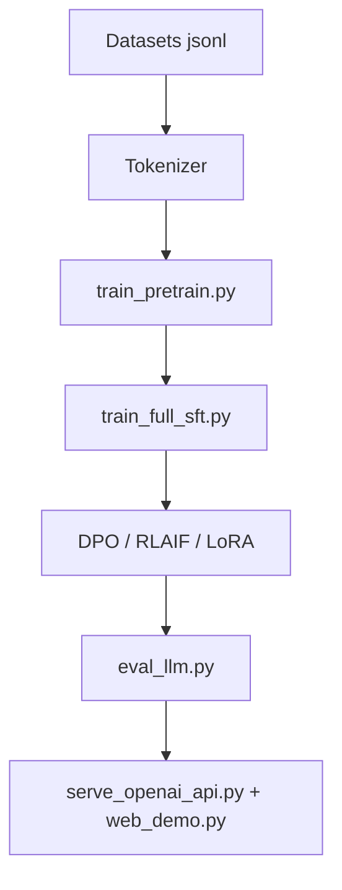

# jingyaogong/minimind

> Code PyTorch pour entraîner de zéro un petit modèle de langage de 64M de paramètres, pour apprendre.

## Le problème
Les bibliothèques comme transformers, trl ou peft cachent le fonctionnement interne d'un LLM en quelques lignes. Difficile de comprendre chaque étape d'un entraînement complet.

## Ce que ça fait vraiment
Fournit le code d'un modèle Dense et MoE (aligné sur Qwen3), un tokenizer de 6 400 tokens et les scripts d'entraînement : pré-entraînement, SFT, LoRA, distillation, DPO, RLAIF (PPO, GRPO, CISPO) et Agentic RL. Les algorithmes sont réécrits en PyTorch natif. Un serveur compatible OpenAI et une page Streamlit servent le résultat. Les jeux de données sont publiés à part (de 1,2 Go à 14 Go).

## Comment c'est branché


## Essayer
```bash
git clone --depth 1 https://github.com/jingyaogong/minimind
cd minimind && pip install -r requirements.txt
cd trainer && python train_pretrain.py
cd trainer && python train_full_sft.py
python eval_llm.py --weight full_sft
```

## Coût et pièges
Annoncé à environ 3 yuans et 2 h sur un GPU 3090 pour l'étape SFT en version « mini ». Les données complètes pèsent 10 Go (pré-entraînement) et 14 Go (SFT). Le modèle de 64M reste limité : le README reconnaît que les connaissances factuelles sont faibles.

## Ce que ce n'est pas
Pas un modèle utilisable en production. Pas un wrapper : tout est réimplémenté, donc rien ne garantit la parité avec transformers. Le tool calling a été entraîné sur une dizaine d'outils simulés, sans généralisation prouvée.

## Alternatives
- transformers / trl / peft : pour affiner vite un modèle existant sans réécrire les algorithmes.
- llama.cpp, vllm, ollama : pour servir ce modèle une fois converti.

## Pour toi
Utile pour comprendre de bout en bout la chaîne pré-entraînement vers RL avec un GPU modeste ; à surveiller et lire, mais pas à déployer.

