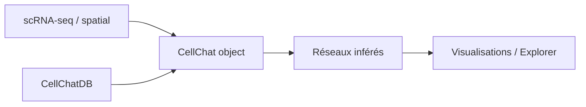

# jinworks/CellChat

> R package to infer and visualize cell-cell communication from single-cell and spatial data.

## The problem
Deducing which cell types talk to each other via ligands and receptors from transcriptomics requires a curated database and network methods.

## What it actually does
Infers communication networks, compares them across conditions, extracts signaling inputs/outputs, with the CellChatDB database (human, mouse) and visualizations. v3 (Spatial CellChat) lives in another repository (SpatialCellChat). Interfaces to Seurat, SingleCellExperiment, Scanpy.

## How it is wired


## Trying it
```bash
Rscript -e 'devtools::install_github("jinworks/CellChat")'
Rscript -e 'devtools::install_github("jinworks/SpatialCellChat")'
pip install umap-learn
```

## Cost and gotchas
Free. Many R dependencies (NMF, circlize, ComplexHeatmap) and installation problems reported depending on the OS; enough RAM required. 371 open issues, the maintainer says they cannot resolve all the errors.

## What it is not
It is not Python. The spatial v3 is not in this repository. The inferred interactions are predictions, not proof.

## Alternatives
No alternative named in the README.

## For you
Worth watching: useful only if you do single-cell biology in R; otherwise outside a typical data/MLOps profile.
