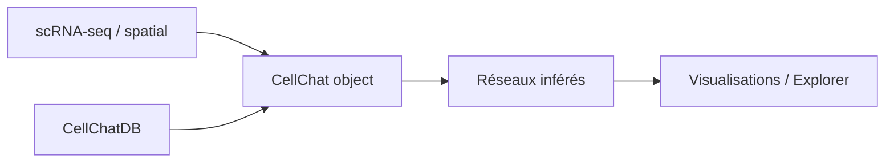

# jinworks/CellChat

> Package R pour inférer et visualiser la communication cellule-cellule à partir de données single-cell et spatiales.

## Le problème
Déduire quels types cellulaires se parlent via ligands et récepteurs à partir de transcriptomique demande une base curée et des méthodes réseau.

## Ce que ça fait vraiment
Infère les réseaux de communication, les compare entre conditions, extrait les entrées/sorties de signalisation, avec base CellChatDB (humain, souris) et visualisations. La v3 (Spatial CellChat) vit dans un autre dépôt (SpatialCellChat). Interfaces vers Seurat, SingleCellExperiment, Scanpy.

## Comment c'est branché


## Essayer
```bash
Rscript -e 'devtools::install_github("jinworks/CellChat")'
Rscript -e 'devtools::install_github("jinworks/SpatialCellChat")'
pip install umap-learn
```

## Coût et pièges
Gratuit. Dépendances R nombreuses (NMF, circlize, ComplexHeatmap) et soucis d'installation signalés selon l'OS ; RAM suffisante requise. 371 issues ouvertes, le mainteneur dit ne pas pouvoir résoudre toutes les erreurs.

## Ce que ce n'est pas
Ce n'est pas du Python. La v3 spatiale n'est pas dans ce dépôt. Les interactions inférées sont des prédictions, pas des preuves.

## Alternatives
Aucune alternative nommée dans le README.

## Pour toi
À surveiller : utile seulement si tu fais de la bio single-cell en R ; sinon hors profil data/MLOps classique.

