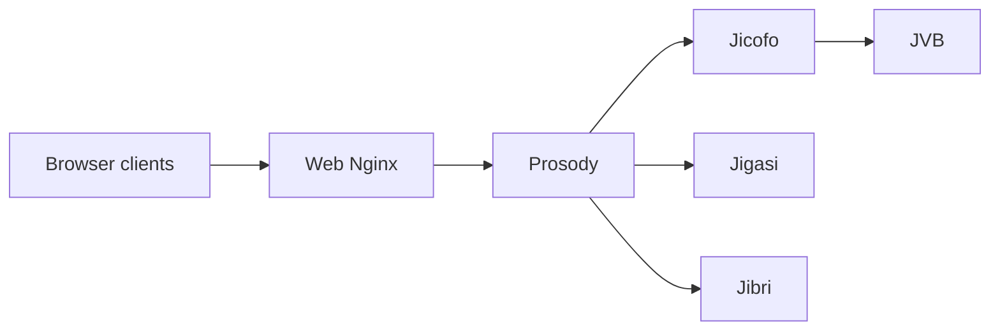

# jitsi/docker-jitsi-meet

> Docker images and Compose files to deploy your own Jitsi Meet video conferencing.

## The problem
Deploying Jitsi by hand requires assembling web, XMPP, conference controller and media bridge.

## What it actually does
`docker-compose.yml` launches Nginx (web), Prosody (XMPP), Jicofo (orchestration) and JVB (media bridge). Overlays add Jigasi (SIP/transcription), Jibri (recording), observability (Prometheus, Loki, Tempo) and RTCStats. An s6-overlay layer generates the configuration from the environment.

## How it is wired


## Trying it
```bash
# non documenté dans le README : le manuel d'installation est en ligne
# fichiers cités : docker-compose.yml, env.example, gen-passwords.sh
```

## Cost and gotchas
Docker and a domain name with TLS. Jibri requires Chromium and a graphical environment; media traffic needs bandwidth on the server side.

## What it is not
Not a hosted service: it is up to you to run it. Kubernetes belongs to another repository.

## Alternatives
- Jitsi on Kubernetes: separate tools and tutorials.

## For you
Worth watching: useful if you must offer internal meetings without SaaS, outside the data/AI scope.
