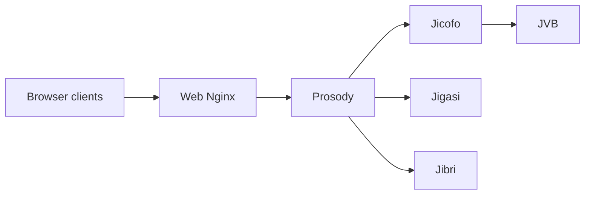

# jitsi/docker-jitsi-meet

> Images Docker et fichiers Compose pour déployer sa propre visioconférence Jitsi Meet.

## Le problème
Déployer Jitsi à la main exige d'assembler web, XMPP, contrôleur de conférence et pont média.

## Ce que ça fait vraiment
`docker-compose.yml` lance Nginx (web), Prosody (XMPP), Jicofo (orchestration) et JVB (pont média). Des surcouches ajoutent Jigasi (SIP/transcription), Jibri (enregistrement), observabilité (Prometheus, Loki, Tempo) et RTCStats. Un étage s6-overlay génère la configuration depuis l'environnement.

## Comment c'est branché


## Essayer
```bash
# non documenté dans le README : le manuel d'installation est en ligne
# fichiers cités : docker-compose.yml, env.example, gen-passwords.sh
```

## Coût et pièges
Docker et un nom de domaine avec TLS. Jibri exige Chromium et un environnement graphique ; le trafic média demande de la bande passante côté serveur.

## Ce que ce n'est pas
Pas un service hébergé : c'est à toi de l'exploiter. Kubernetes relève d'un autre dépôt.

## Alternatives
- Jitsi sur Kubernetes : outils et tutoriels séparés.

## Pour toi
À surveiller : utile si tu dois offrir des réunions en interne sans SaaS, hors du périmètre data/IA.

