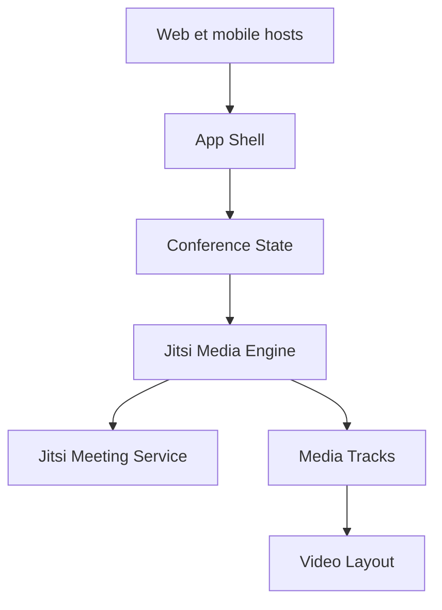

# jitsi/jitsi-meet

> Open source, self-hostable video conferencing, with web and mobile SDKs, for teams that want to control their tool.

## The problem
Video conferencing services impose their platform, their brand and their terms.

## What it actually does
Web and mobile application (HD, screen sharing, chat, polls, virtual backgrounds) that connects to the lib-jitsi-meet engine. State is managed with Redux. Web and native SDKs allow embedding it. The public instance meet.jit.si is free. You can self-host via Debian packages or a Docker setup, or use 8x8's commercial JaaS offering.

## How it is wired

## Trying it
No documented command in the README: it points to the handbook for Debian or Docker installation.

## Cost and gotchas
Free when self-hosted, but you carry the operations (updates, scaling). The public instance requires a Google, Facebook or GitHub account to start a meeting. JaaS is paid.

## What it is not
It is not a transcription or AI tool. The README gives no server sizing. The meeting server is deployed separately from this interface repository.

## Alternatives
No alternative named in the README.

## For you
Worth watching: interesting for hosting your own meetings, but unrelated to data / AI work itself.
