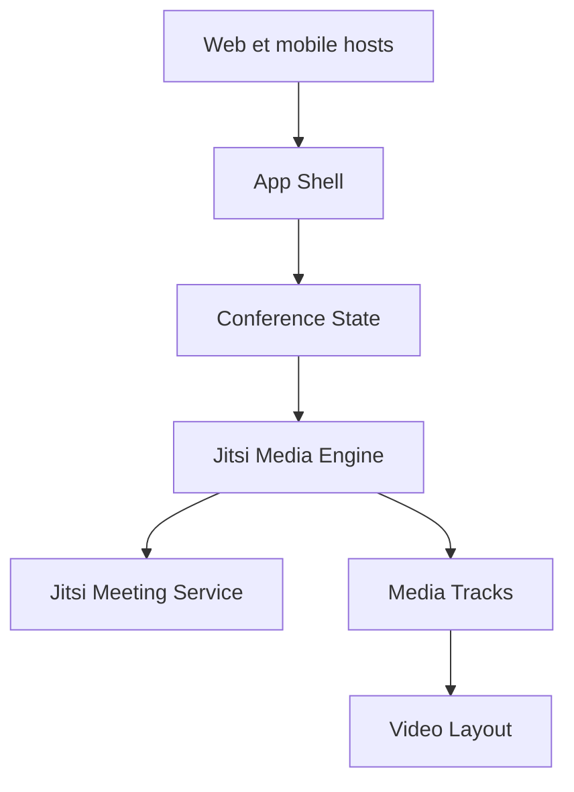

# jitsi/jitsi-meet

> Visioconférence open source auto-hébergeable, avec SDK web et mobile, pour équipes qui veulent maîtriser leur outil.

## Le problème
Les services de visioconférence imposent leur plateforme, leur marque et leurs conditions.

## Ce que ça fait vraiment
Application web et mobiles (HD, partage d'écran, chat, sondages, fonds virtuels) qui se connecte au moteur lib-jitsi-meet. L'état est géré avec Redux. Des SDK web et natifs permettent de l'intégrer. L'instance publique meet.jit.si est gratuite. On peut auto-héberger via paquets Debian ou une configuration Docker, ou passer par l'offre commerciale JaaS de 8x8.

## Comment c'est branché

## Essayer
Aucune commande documentée dans le README : il renvoie vers le handbook pour l'installation Debian ou Docker.

## Coût et pièges
Gratuit en auto-hébergement, mais tu portes l'exploitation (mises à jour, montée en charge). L'instance publique demande un compte Google, Facebook ou GitHub pour démarrer une réunion. JaaS est payant.

## Ce que ce n'est pas
Ce n'est pas un outil de transcription ni d'IA. Le README ne donne pas de dimensionnement serveur. Le serveur de réunion se déploie à part de ce dépôt d'interface.

## Alternatives
Aucune alternative nommée dans le README.

## Pour toi
À surveiller : intéressant pour héberger tes propres réunions, mais sans lien avec le travail data / IA lui-même.

