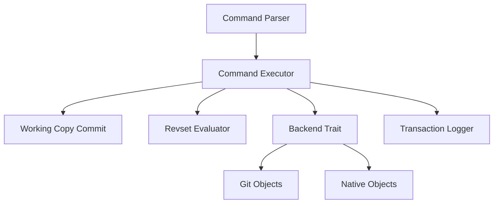

# jj-vcs/jj

> Git-compatible version control system, for developers who want a history that is easier to rewrite.

## The problem
Git imposes interactive index, stash and rebase, plus blocking conflicts, which complicate history rewriting.

## What it actually does
`jj` stores in Git, but treats the working copy as an automatically amended commit, with no index or stash. Every operation is recorded in a log and can be undone. When you modify a commit, its descendants are rebased automatically. Conflicts are recorded in the commits instead of interrupting the operation. A selection language (revsets) comes from Mercurial.

## How it is wired


## Trying it
```bash
jj help rebase
jj help -k config
```
For installation and the tutorial: docs.jj-vcs.dev/latest/install-and-setup.

## Cost and gotchas
Free. The README calls itself "experimental" with possible on-disk format changes before 1.0, and without full Git submodule support. Performance is flagged as improvable.

## What it is not
Not a host or a GitHub replacement: it uses existing Git forges. Not a product supported by Google, even though Googlers contribute to it.

## Alternatives
- Mercurial and Breezy: cited as possible backends or sources of inspiration.

## For you
Worth watching: useful if you often rewrite commits (notebooks, experiments), but the gain does not justify a team migration until the format is stabilised.
