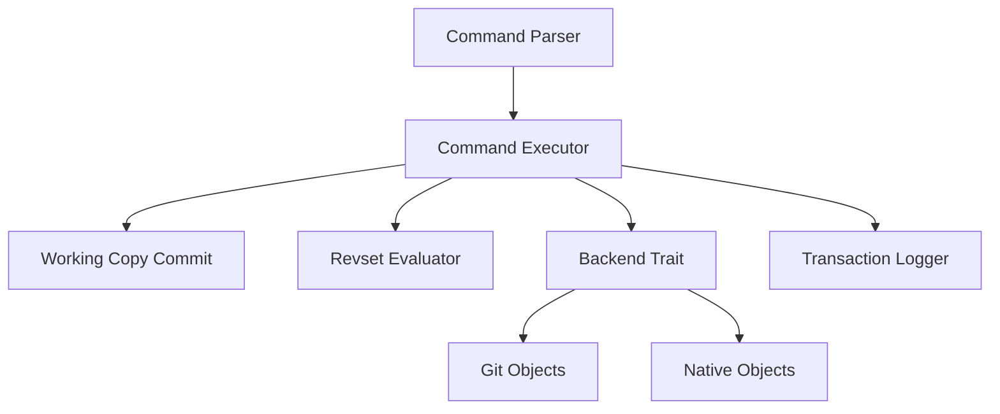

# jj-vcs/jj

> Système de gestion de versions compatible Git, pour développeurs qui veulent un historique plus facile à réécrire.

## Le problème
Git impose index, stash, rebase interactifs et conflits bloquants qui compliquent la réécriture d'historique.

## Ce que ça fait vraiment
`jj` stocke dans Git, mais traite la copie de travail comme un commit amendé automatiquement, sans index ni stash. Chaque opération est enregistrée dans un journal et annulable. Quand tu modifies un commit, ses descendants sont rebasés automatiquement. Les conflits sont enregistrés dans les commits au lieu d'interrompre l'opération. Un langage de sélection (revsets) vient de Mercurial.

## Comment c'est branché


## Essayer
```bash
jj help rebase
jj help -k config
```
Pour l'installation et le tutoriel : docs.jj-vcs.dev/latest/install-and-setup.

## Coût et pièges
Gratuit. Le README se dit « expérimental » avec des changements possibles de format disque avant la 1.0, et sans sous-modules Git complets. Les performances sont signalées comme perfectibles.

## Ce que ce n'est pas
Pas un hébergeur ni un remplaçant de GitHub : il utilise les forges Git existantes. Ce n'est pas un produit supporté par Google, même si des Googlers y contribuent.

## Alternatives
- Mercurial et Breezy : cités comme backends possibles ou sources d'inspiration.

## Pour toi
À surveiller : utile si tu réécris souvent des commits (notebooks, expériences), mais le gain ne compense pas une migration d'équipe tant que le format n'est pas stabilisé.

