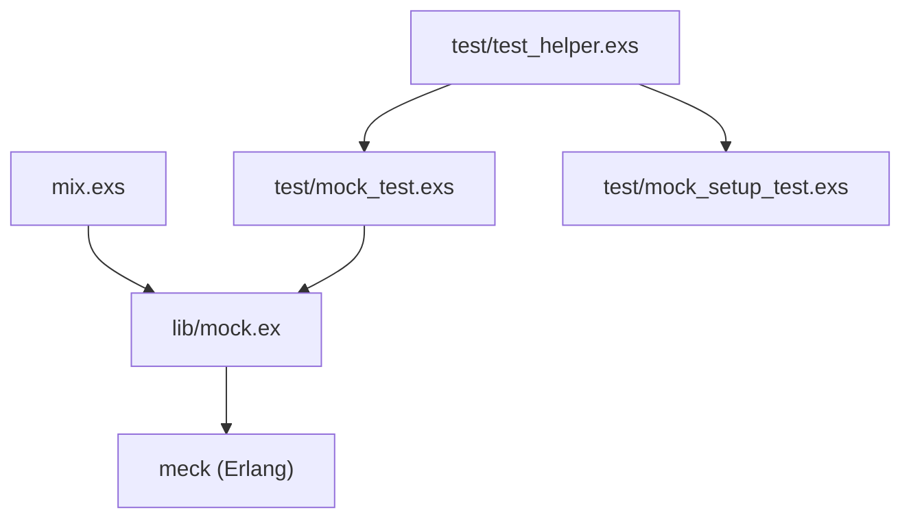

# jjh42/mock

> Module mocking library for Elixir tests, built on the Erlang library meck.

## The problem
Testing code that calls external services without contacting them requires replacing modules.

## What it actually does
Macros `with_mock`, `with_mocks`, `test_with_mock`, `setup_with_mocks`, plus `assert_called`, `assert_not_called` and counting variants. The replacement relies on meck. Limits: not with `async: true`, only qualified calls are mocked, no macro mocking.

## How it is wired


## Trying it
```bash
mix deps.get
# mix.exs : {:mock, "~> 0.3.0", only: :test}
```

## Cost and gotchas
Free. Global effect: disable `async` in the affected test modules. Last push in December 2024.

## What it is not
Not a tool for mocking internal functions: they are not replaced, the README describes a workaround.

## Alternatives
No alternative named in the README.

## For you
Only useful in Elixir and with no recent activity: ignore.
