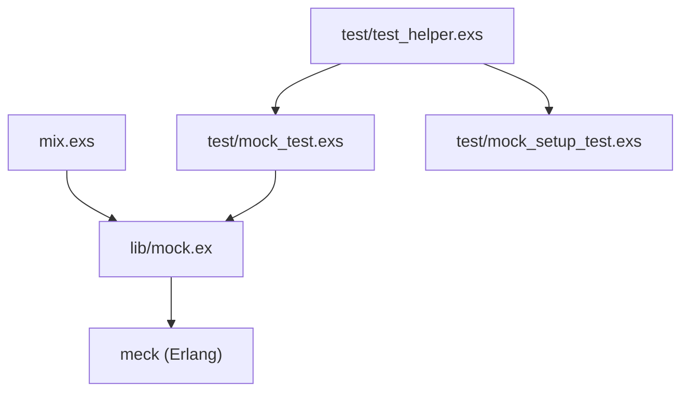

# jjh42/mock

> Bibliothèque de simulation de modules pour les tests Elixir, bâtie sur la bibliothèque Erlang meck.

## Le problème
Tester du code qui appelle des services externes sans les contacter exige de remplacer des modules.

## Ce que ça fait vraiment
Macros `with_mock`, `with_mocks`, `test_with_mock`, `setup_with_mocks`, plus `assert_called`, `assert_not_called` et variantes de comptage. Le remplacement s'appuie sur meck. Limites : pas en `async: true`, seuls les appels qualifiés sont simulés, pas de simulation de macros.

## Comment c'est branché


## Essayer
```bash
mix deps.get
# mix.exs : {:mock, "~> 0.3.0", only: :test}
```

## Coût et pièges
Gratuit. Effet global : désactiver `async` dans les modules de test concernés. Dernier push en décembre 2024.

## Ce que ce n'est pas
Pas un outil de simulation de fonctions internes : elles ne sont pas remplacées, le README décrit un contournement.

## Alternatives
Aucune alternative nommée dans le README.

## Pour toi
Utile seulement en Elixir et sans activité récente : à ignorer.

