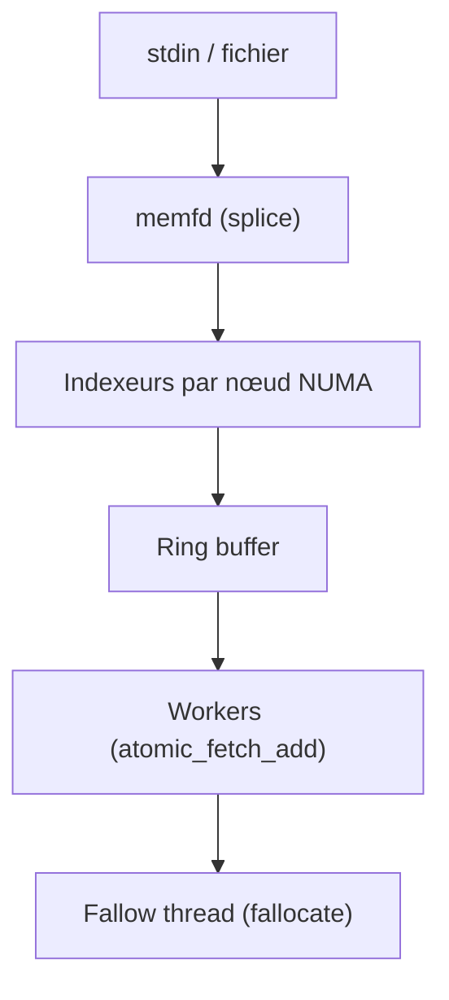

# jkool702/forkrun

> Streaming bash parallelizer that replaces GNU Parallel and `xargs -P` on multicore and NUMA machines.

## The problem
GNU Parallel spends a lot of time distributing the work: on many cores, most of them sit idle.

## What it actually does
`frun.bash` is a single file to source, with a built-in compiled C extension. Data enters through `splice()` into a memfd, per-NUMA-node SIMD indexers split it into batches, and workers claim them with an `atomic_fetch_add`. A batch lost by a dead worker is picked up again. The README figures are the author's own measurements on an i9-7940X. A Python frontend also exists.

## How it is wired
Simplified diagram based on the sheet, no diagram provided.


## Trying it
```bash
wget https://raw.githubusercontent.com/jkool702/forkrun/main/frun.bash
source ./frun.bash
frun my_bash_func < inputs.txt
cat file_list | frun -k sed 's/old/new/'
```

## Cost and gotchas
Free. Bash 4.4 or later, Linux 3.17 or later, GNU coreutils, x86_64 first. A base64 binary is executed on import: the author points to their CI workflow for the audit.

## What it is not
It is not useful under 100,000 lines, nor for GPU tasks. The 50x to 3300x gains are microbenchmarks.

## Alternatives
The README compares it with GNU Parallel and `xargs -P`.

## For you
Worth watching: interesting for preparing large files in the shell, but it executes an embedded binary and is still young.
